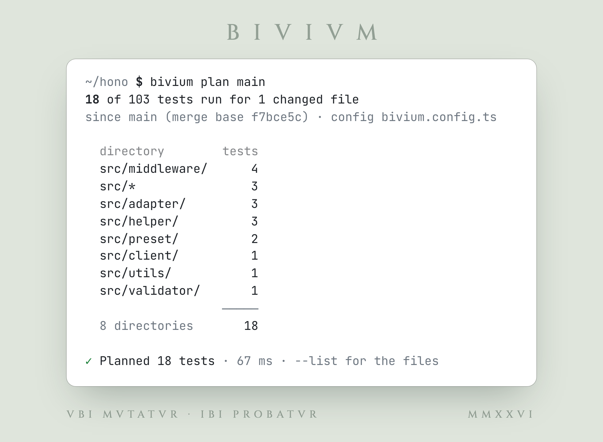
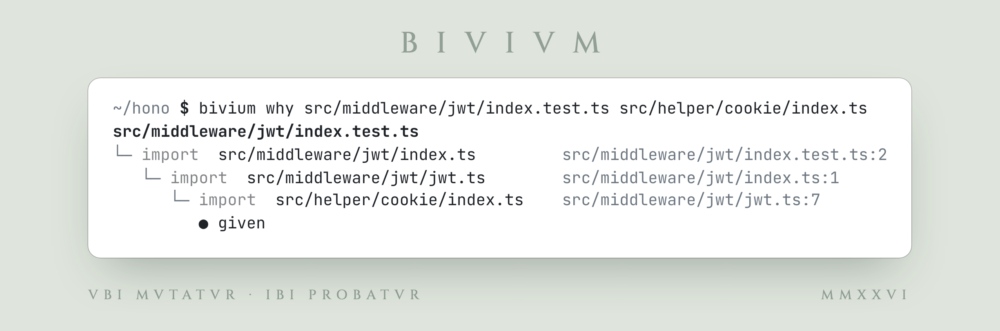
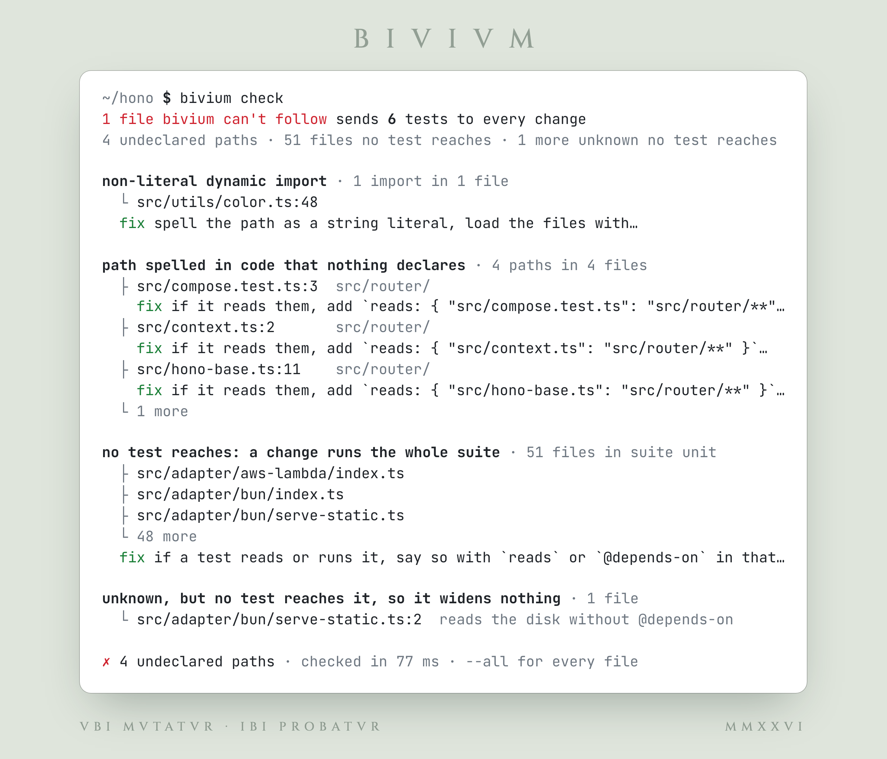

# bivium

Run only the tests your change can reach.

bivium reads your code's imports to work out which tests a change could
break, and hands those to your test runner: Vitest, Jest, Playwright,
`bun test`, or any other.
When it can't tell what a change touches, it runs everything,
and says why.

<picture>
  <source media="(prefers-color-scheme: dark)" srcset="https://raw.githubusercontent.com/metonym/bivium/master/.github/assets/plan-dark.png">
  
</picture>

That's [Hono](https://github.com/honojs/hono),
a branch that edits its cookie helper.

Piped, or with `--list`, it prints the files, one per line.

**Every selection has a reason.**
`why` shows how a change reaches a test, file by file,
with the line that connects each one:

<picture>
  <source media="(prefers-color-scheme: dark)" srcset="https://raw.githubusercontent.com/metonym/bivium/master/.github/assets/why-dark.png">
  
</picture>

**It says what it can't see.**
`check` lists every file whose dependencies it can't read,
what each costs, and the fix:

<picture>
  <source media="(prefers-color-scheme: dark)" srcset="https://raw.githubusercontent.com/metonym/bivium/master/.github/assets/check-dark.png">
  
</picture>

It has no dependencies and runs on Node ≥ 22 or Bun.
It started as the `test:changed` script
in
[carbon-components-svelte](https://github.com/carbon-design-system/carbon-components-svelte).

## Quick start

```sh
bun add -d bivium
```

```ts
// bivium.config.ts
import { defineConfig } from "bivium";

export default defineConfig({
  suites: {
    unit: { tests: "tests/**/*.test.ts", run: "vitest run {files}", root: "tests" },
  },
  roots: ["src", "tests"], // a changed file outside them runs everything
});
```

```sh
bunx bivium plan          # which tests this branch needs
bunx bivium run           # run them: vitest run tests/Button.test.ts …
```

Exit status: 0 when done, 1 when `check` finds problems, 2 for an error;
`run` exits with its command's status.

## Common tasks

```sh
# Plan against a ref you name, as data
bivium plan origin/main --json

# Run one suite's selection
bivium run --suite e2e

# Why does this test run, or not?
bivium why tests/Button.test.ts

# What bivium can't see, each with its fix
bivium check

# Which files reach the most tests
bivium graph --top 10

# In GitHub Actions: write each suite's selection to the step's outputs
bivium plan origin/main --github
```

With `--json`, every command prints data with a `schemaVersion`,
and an error prints `{ "error": { "kind", "code", "message" } }` too.
These docs ship in the package, at `node_modules/bivium/docs/`.

## From code

```ts
import { defineConfig, plan } from "bivium";

const config = defineConfig({ suites: { unit: { tests: "tests/**/*.test.ts" } } });
const result = await plan({ config, base: "origin/main" });
result.suites.unit; // { mode: "some", files: [...] }; result.suites.e2e is a type error
```

## Docs

- [Config](https://github.com/metonym/bivium/blob/master/docs/config.md):
  every key, and the `@depends-on`, `@reads` and `@lists` comments
- [Tuning a plan](https://github.com/metonym/bivium/blob/master/docs/tuning.md):
  when a change runs too much, and what `check` reports
- [Recipes](https://github.com/metonym/bivium/blob/master/docs/recipes.md):
  Vitest, Jest, Playwright, pnpm workspaces, generated code
- [CLI](https://github.com/metonym/bivium/blob/master/docs/cli.md):
  every command and option, the JSON, and reading `why`
- [CI](https://github.com/metonym/bivium/blob/master/docs/ci.md): GitHub
  Actions, the checkout a plan needs, the cache, and what a plan costs
- [API](https://github.com/metonym/bivium/blob/master/docs/api.md):
  `plan()`, and narrowers for generated files
- [How it works](https://github.com/metonym/bivium/blob/master/docs/how-it-works.md):
  what the graph follows, lockfiles, and how bivium compares with
  `vitest --changed`, Playwright, Nx and Bazel
